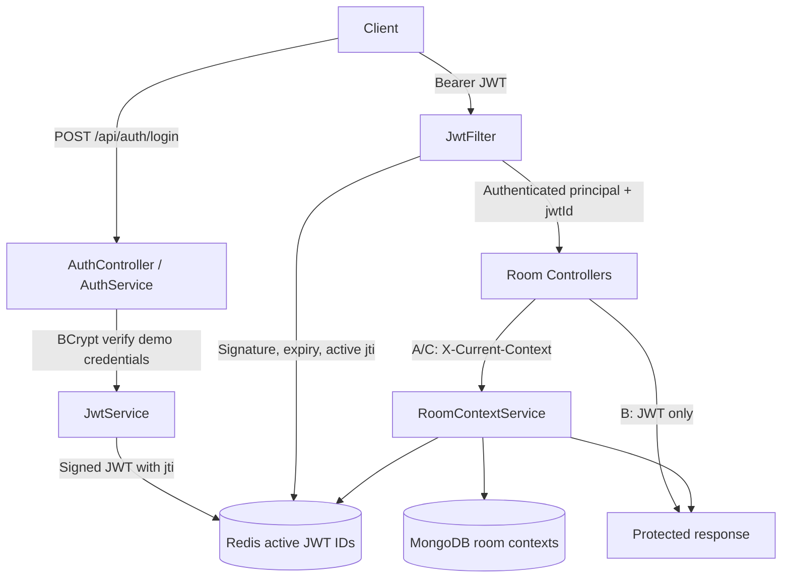

# JWT and Current Context Architecture

## Request lifecycle
1. Login verifies the configured demo username and BCrypt-encoded password, then issues a signed JWT with a unique ID.
2. Redis stores an active-token key with the same TTL as the JWT.
3. The JWT filter validates the signature and expiration and checks Redis before setting the security context.
4. Room A and C additionally require a room-, user-, and JWT-session-bound context ID backed by MongoDB and Redis. Room B requires only JWT.
5. Context revocation deactivates MongoDB state and deletes its Redis key. Logout deletes the active JWT key.

## Security scope
This is a learning demonstration, not a production identity provider. Demo credentials and signing key must be supplied via environment variables. Never commit real secrets. Use HTTPS, rate limits, external identity management, and integration tests for production.
